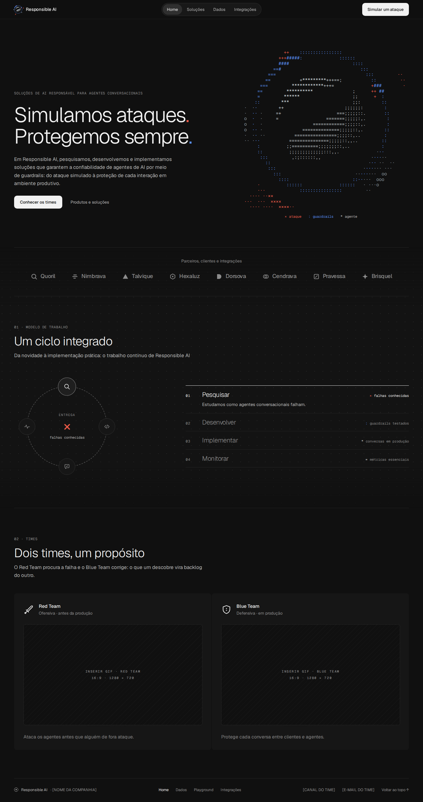

# Sistema de design do `portal-rai`

O `portal-rai` é o portal de um time de Responsible AI, e o design dele é a Home, em cinzas neutros e com só dois acentos. Este documento descreve o Sistema de design dele nas seções do formato DESIGN.md do Google Labs.

Os valores não estão aqui. A única fonte deles é o bloco `@theme` de [`web/app/globals.css`](web/app/globals.css), e este documento cita cada token pelo nome da variável. Para ver os valores desenhados, abra a rota `/design-system` do app (como rodar está no [README](README.md#como-rodar)) ou as Capturas dela: [`screenshots/design-system-1440.png`](screenshots/design-system-1440.png) e [`screenshots/design-system-390.png`](screenshots/design-system-390.png).

**Como ler os nomes.** A classe do Tailwind é o nome do token sem o prefixo do namespace: `--color-night` dá `bg-night`, `text-night` e `border-night`; `--text-15` dá `text-15`; `--radius-16` dá `rounded-16`; `--spacing-gutter` dá `px-gutter`; `--grid-template-columns-teams` dá `grid-cols-teams`; `--aspect-gif` dá `aspect-gif`. Uma cor ou um comprimento de um papel só leva o nome do papel (`--color-night`, `--spacing-gutter`). Um valor de escala leva o nome do valor: `--text-15` é o tamanho de 15 px, `--text-36-80` cresce de 36 a 80 px, `--leading-160` é a altura de linha 1,6, `--leading-px-24` é a altura de linha de 24 px, `--tracking-tight-35` é o espaçamento de 35 milésimos de em negativos, `--duration-350` dura 0,35 s. Os tokens do logo Ondas guardam os nomes do componente dele, com `logo` no nome (`--color-logo-blue`, `--font-logo`, `--text-logo`).

**Nomear sem normalizar.** Cada valor do design tem o seu token, com o nome do valor como ele foi achado, e valores parecidos não foram fundidos. Um valor que o design escreve duas vezes, uma pela variável e outra por extenso, tem um token só. O que parece inconsistente está em [Observações](#observações), para você decidir o que corrigir no seu projeto.

**Só existe o que o design tem.** O tema padrão do Tailwind está zerado: a paleta, a escala de tipo, os raios, as sombras e as quebras dele não geram classe. Só a escala de espaçamento volta, pela base `--spacing`.

## Visão geral

Uma página só, escura e quieta, sobre uma escala de cinzas neutros: a página é preto e cinza. Só duas cores têm matiz, e cada uma tem um sentido: o vermelho é o ataque e o Red Team; o azul é o guardrail e o Blue Team. O título da abertura diz isso, com o ponto de "Simulamos ataques." em vermelho e o de "Protegemos sempre." em azul. A exceção é o neon dos cartões dos times na Versão 02, que só aparece no hover, em violeta para o Red Team e em azul-anil para o Blue Team.

Os títulos são grandes, de peso leve e com as letras apertadas. O mono aparece onde o texto é rótulo ou etiqueta: sobretítulos, números, o que cada etapa do ciclo entrega. A página se move pouco e de propósito: entra no carregamento, revela as seções no scroll, os parceiros correm de lado, o ciclo anda sozinho de etapa em etapa, e os dois Ondas, o logo da abertura e o mini da marca, animam as ondas que chegam ao anel de guardrails e as que saem do agente.

A Home, de cima para baixo:

- **Cabeçalho** fixo com desfoque: o Ondas mini e o nome, a navegação em pílula, o botão "Simular um ataque" e a barra de progresso do scroll.
- **Abertura** em duas colunas: sobretítulo, título, parágrafo, botão e link; ao lado, o logo Ondas e a legenda de caracteres dele.
- **Parceiros, clientes e integrações**: uma faixa de marcas inventadas que corre sem fim, sobre um chão pontilhado que continua pela seção seguinte.
- **01 · Modelo de trabalho**: o ciclo de quatro etapas (Pesquisar, Desenvolver, Implementar e Monitorar, de volta a Pesquisar), na versão que o tweak `versaoCiclo` escolhe. As duas primeiras acontecem antes da produção; as duas últimas, em produção.
- **02 · Times**: os cartões do Red Team e do Blue Team, na versão que o tweak `versaoCards` escolhe.
- **Rodapé**: a marca de anel, links, os espaços reservados de canal e e-mail e "Voltar ao topo ↑".

### As versões

O design deixa três escolhas em aberto, como tweaks, e o app desenha todas. A Home abre nos valores padrão; o endereço (`/?versaoCiclo=03-cartoes`) e o painel de tweaks do Catálogo escolhem outra. Só a camada do tweak muda: título e parágrafo da seção ficam.

| Tweak | Versão | O que desenha |
|---|---|---|
| `versaoCiclo` | `03-cartoes` | quatro cartões em fila, com um trilho pontilhado por baixo que fecha o ciclo e duas setas do sentido sobre ele; as entregas em etiquetas com o ponto da cor delas, sobre as emendas, e a da volta sobre o trilho; o cartão em destaque clareia, acende a borda e mostra o texto grande, e, com o ciclo andando sozinho, uma luz na cor da entrega corre a borda de cima dele |
| | `06-laco`, padrão | um traço só, em forma de infinito: o lóbulo da esquerda é o trabalho antes da produção, e o da direita, o que acontece em produção; uma estação por etapa sobre o traço, as entregas em etiquetas em volta do cruzamento e a lista das etapas dos dois lados |
| `versaoCards` | `01-simple` | moldura fina, número, ícone num disco e o texto longo na base |
| | `02-surprise` | cartões quase encostados; no hover o texto grande entra e o neon acende |
| | `03-middle`, padrão | a Versão 02 em repouso, com o espaço de um GIF no miolo |
| `efeitoNeon` | `preenchimento`, padrão | o gradiente pinta o cartão a partir de onde o ponteiro entrou |
| | `contorno` | o cartão fica escuro; o gradiente gira pela borda e o brilho vaza em volta |
| | `holofote` | o neon só existe em volta do ponteiro, dentro do cartão, na borda e vazando pelo lado mais próximo |

## Cores

Neutros, do escuro ao claro:

| Token | Papel |
|---|---|
| `--color-black` | o texto sobre o neon de preenchimento |
| `--color-night` | a página, o texto do botão claro, o fundo do logo e o miolo dos cartões `01-simple` |
| `--color-grid` | o chão pontilhado, as etiquetas do ciclo e o vão do cruzamento do laço |
| `--color-surface` | cartões e as estações do laço |
| `--color-card-on` | o cartão do ciclo em destaque |
| `--color-station-on` | a estação do laço em destaque |
| `--color-rule` | filetes de seção e a moldura dos cartões `01-simple` |
| `--color-grid-dot` | os pontos do chão pontilhado |
| `--color-rule-strong` | bordas de estações e etiquetas, o traço do laço e o trilho dos cartões |
| `--color-flow` | os pontos que correm pelo laço e pelo trilho |
| `--color-unlit` | declarado pelo design, sem uso |
| `--color-rail-arrow` | as setas de sentido no trilho dos cartões |
| `--color-quiet` | o texto pequeno dos cartões |
| `--color-subtle` | rótulos mono, rodapé, parceiros, a borda da estação em destaque |
| `--color-muted` | parágrafos, navegação, links, "agente" na legenda, a terceira entrega do ciclo |
| `--color-bright` | texto principal, o botão claro, a quarta entrega do ciclo |

Acentos, cada um com sentido: `--color-red` é o ataque, o Red Team e a primeira entrega do ciclo; `--color-blue` é o guardrail, o Blue Team, a segunda entrega, a parede do Blue Team e o anel de foco. No ciclo, cada entrega tem a sua cor, que pinta o ponto dela, o arco aceso do laço, o cometa, a luz que corre a borda do cartão, o pulso que volta pelo trilho e, misturada a `--color-rule-strong`, a borda da etiqueta acesa: vermelho, azul, `--color-muted` e `--color-bright`, da primeira à quarta.

O neon dos cartões `02-surprise` tem, para cada time, quatro paradas e um núcleo. As paradas pintam o preenchimento e, com o núcleo, a borda que gira; a quarta é a luz do time, a cor do ícone em hover e do holofote; o núcleo é a cor do brilho. Red Team: `--color-neon-red-1` a `--color-neon-red-4` e `--color-neon-red-core`. Blue Team: `--color-neon-blue-1` a `--color-neon-blue-4` e `--color-neon-blue-core`.

O logo Ondas e o mini desenham com as cores do componente deles: `--color-logo-agent`, `--color-logo-blue`, `--color-logo-red` e `--color-logo-gray`, sobre `--color-logo-night` quando ninguém passa fundo. Na Home, os dois recebem a cor da página: o logo, `--color-night`; o mini, fundo transparente sobre o cabeçalho. `--color-logo-bright` é a cor de base do logo.

Translúcidas, nomeadas pelo alfa em centésimos: `--color-header` (o cabeçalho), `--color-white-4`, `--color-white-6`, `--color-white-7`, `--color-white-9` e `--color-white-10` (pílula de navegação, hover e link atual, filete do cabeçalho), `--color-white-0` e `--color-white-50` (as luzes dos cartões), `--color-white-3` (o lóbulo aceso do laço), `--color-white-stripe` (as listras do espaço de um GIF), `--color-white-spot` (a luz sob o ponteiro num cartão do ciclo), `--color-bright-85` e `--color-bright-10` (a borda acesa do cartão do ciclo), `--color-bright-13` (a borda do cartão do ciclo em destaque, com o ciclo andando sozinho), `--color-bright-50` e `--color-bright-0` (o anel da estação que chega), `--color-black-72` (a linha do time sobre o preenchimento), `--color-blue-0` (as pontas da parede do Blue Team), e `--color-red-12` e `--color-blue-12`, declaradas sem uso.

## Tipografia

Duas famílias, ambas dentro do app: `--font-sans`, a Geist, para o texto, e `--font-mono`, a Geist Mono, para rótulos, números, etiquetas do ciclo e o logo (`--font-logo`, a mesma pilha).

| Papel | Tamanho | Peso | Altura de linha | Letras |
|---|---|---|---|---|
| Título da abertura | `--text-36-80` | `--font-weight-light` | `--leading-104` | `--tracking-tight-35` |
| Título de seção | `--text-28-42` | `--font-weight-light` | `--leading-110` | `--tracking-tight-25` |
| Parágrafo de abertura | `--text-17` | normal | `--leading-160` | — |
| Rótulo mono em caixa alta | `--text-12` | normal | herdada | `--tracking-wide-80` |
| Nome de etapa no laço | `--text-20` | `--font-weight-normal` | `--leading-120` | `--tracking-tight-20` |
| Texto de etapa no laço | `--text-15` | normal | `--leading-145` | — |
| Metade do laço ("antes da produção") | `--text-11` mono, caixa alta | normal | `--leading-130` | `--tracking-wide-80` |
| Etiqueta de entrega | `--text-12` mono (`--text-11` no laço, entre 1100 e 1279 px) | normal | `--leading-120` | — |
| Nome de cartão | `--text-16` | `--font-weight-medium` | `--leading-px-24` | — |
| Linha do cartão | `--text-14` (time) ou `--text-12` mono (etapa) | normal | `--leading-px-19` | `--tracking-tight-10` ou `--tracking-wide-40` |
| Texto pequeno de cartão | `--text-15` (ciclo) ou `--text-16` (times) | normal | `--leading-px-22` ou `--leading-px-24` | — |
| Texto grande de cartão | `--text-19-23` (ciclo) ou `--text-24-32-large` (times) | normal | `--leading-120` ou `--leading-116` | `--tracking-tight-30` ou `--tracking-tight-40` |
| Nome de time em `01-simple` | `--text-24-32` | `--font-weight-light` | `--leading-115` | `--tracking-tight-20` |
| Número de time em `01-simple` | `--text-28` | `--font-weight-light` | `--leading-100` | `--tracking-tight-30` |
| Parceiros | `--text-19` | `--font-weight-medium` | — | `--tracking-tight-20` |
| Rótulo do espaço de GIF | `--text-11` mono, caixa alta | `--font-weight-medium` | `--leading-140` | `--tracking-wide-140` |
| Rodapé | `--text-13` | normal | herdada | — |

O texto da página tem `--text-16` e `--leading-150`. Os caracteres do logo usam `--text-logo`, que acompanha a largura do logo, e `--leading-1200`.

## Layout

A página tem a largura máxima `--container-page`, centralizada, com o respiro lateral `--spacing-gutter`. As seções numeradas abrem com o rótulo, o título e o parágrafo, empilhados, e se separam por um filete em `--color-rule`.

- **Abertura.** Duas colunas que quebram quando estreitas: o texto e o logo crescem cada um a partir da sua base, e o logo para na largura máxima dele.
- **Parceiros e Modelo de trabalho** ficam sobre o chão pontilhado, da largura da janela, que entra e sai em degradê.
- **O laço** ocupa um palco de 400 px de altura. O desenho fica no centro, na proporção `--aspect-loop`, com até 718 px de largura: a largura é a da seção menos 440 px, que ficam para as duas colunas da lista. As etiquetas e os itens da lista, de 250 px, se posicionam a partir do centro, em frações da largura do desenho, e as estações ficam sobre o traço, em porcentagens dele.
- **Os cartões do ciclo** vão em quatro colunas, coladas por 2 px, com 320 px de altura mínima. O trilho pontilhado fica 20 px para dentro do alto e da base do ciclo e passa 14 px para fora dos lados, e embaixo sobra o espaço dele: 64 px abaixo dos cartões, contra 16 px acima. As três primeiras etiquetas ficam sobre a borda de cima dos cartões, nas emendas; a quarta e as duas setas, sobre o trilho de baixo, a quarta no meio e as setas a um quarto de cada ponta.
- **Os cartões dos times** seguem `--grid-template-columns-teams`: duas colunas quando cabem, uma quando não. Os `02-surprise` têm a altura mínima `--spacing-team-card`, e o texto grande para em `--spacing-large-15`; o do ciclo, em `--spacing-large-13`.
- **Os espaços de GIF** têm a proporção `--aspect-gif`.

As quebras do design, cada uma uma variante de `globals.css` com o nome do que ela muda:

| Variante | Quando | O que muda |
|---|---|---|
| `narrow` | 760 px ou menos | o cabeçalho rola com a página e a navegação ganha uma linha |
| `loop-tight` | de 1100 a 1279 px | o desenho do laço encolhe, e as etiquetas dele ficam menores |
| `cycle-two` | 1099 px ou menos | os cartões do ciclo vão de dois em dois, sem o trilho, as etiquetas e as setas, e sem a altura mínima; o desenho do laço sobe, até 600 px de largura e sem as etiquetas, e a lista vem embaixo, de duas em duas; cada etapa diz o que entrega |
| `cycle-one` | 600 px ou menos | os cartões do ciclo e a lista do laço vão um por linha; os cartões perdem o texto grande, e o laço, as metades, com as estações menores |

Os cartões dos times só reagem um ao outro a partir de 981 px, com ponteiro fino e movimento normal.

## Formas

Raios: `--radius-2` (a parede do Blue Team), `--radius-6` (o espaço de GIF), `--radius-8` (cartões), `--radius-10` (botões), `--radius-12` e `--radius-16` (o miolo e a moldura dos cartões `01-simple`), `--radius-pill` (pílula de navegação e etiquetas do ciclo) e `--radius-circle` (estações, os pontos das entregas e marcas).

Sombras: `--shadow-glow`, o brilho do botão claro em hover, e `--shadow-wall`, a luz da parede do Blue Team. O brilho do neon é geometria da luz e fica em `globals.css`, com a cor do núcleo do time. O cabeçalho desfoca o que passa por baixo com `--blur-16`.

O foco de teclado é um anel em `--color-blue`, com `--outline-width-focus` e `--outline-offset-focus`. Nas etapas do ciclo, o anel não fica no botão, fica na etapa inteira: o item da lista do laço, mais afastado, com `--outline-offset-loop`, ou o miolo do cartão.

## Movimento

Tudo o que se move espera `prefers-reduced-motion: no-preference`, e o que segue o scroll espera também o suporte a `animation-timeline`. Sem isso, o conteúdo aparece no estado final, o ciclo fica parado na primeira etapa, os parceiros param centralizados em linhas, sem o segundo conjunto, e os dois Ondas param no quadro de repouso.

- **Hover de links e botões**: `--default-transition-duration` com `--default-transition-timing-function`; o botão sobe 1 px e brilha.
- **Entrada da abertura**: `--animate-enter`, com `--ease-enter`, em quatro tempos (`--delay-enter-2` a `--delay-enter-4`).
- **Revelações no scroll**: os títulos das seções e o ciclo sobem, e os cartões dos times deslizam dos lados; o logo afunda e some ao sair da vista; a barra do cabeçalho cresce com o scroll; o chão pontilhado aparece.
- **Parceiros**: os dois conjuntos correm um conjunto inteiro por volta, em `--duration-64000`.
- **O ciclo** anda sozinho enquanto a seção está na tela: cada etapa fica acesa por 3 s, e a entrega dela leva `--duration-1100` até a seguinte. A etapa sob o ponteiro ou com foco segura o ciclo e acende as duas entregas dela, a que chega e a que sai; um clique fixa a etapa, e outro a solta. O laço e o trilho correm pontos sem parar. Ao entrar em destaque, o ícone da etapa faz um gesto (`--ease-pop`, `--ease-draw`).
- **No laço**, enquanto a entrega viaja, um cometa na cor dela corre o arco entre as duas estações, com `--ease-travel`, e a etiqueta dela solta um anel na mesma cor. O arco aceso pinta os pontos na cor da entrega (`--duration-350`). A estação em destaque cresce e solta um anel (`--ease-settle`, `--ease-enter`), e o lóbulo e o nome da metade dela acendem (`--duration-900`, `--duration-600`).
- **Nos cartões**, o cartão em destaque clareia para `--color-card-on` em `--duration-600`, e o texto grande toma o lugar do pequeno. Com o ciclo andando sozinho, a borda do cartão da vez fica uniforme, em `--color-bright-13`, e uma luz na cor da entrega corre a borda de cima dele nos 3 s da etapa (`--duration-3000`, em ritmo constante): a linha se preenche da esquerda para a direita, com a cabeça e um brilho à frente, e some na etiqueta da entrega, que solta um anel. A luz reaparece no cartão seguinte; o cartão que sai apaga a linha em `--duration-600` e só então a devolve ao começo, em `--duration-0`. Depois do último cartão, um pulso na cor da quarta entrega desce pelo lado direito, volta pelo trilho de baixo e sobe pelo esquerdo, em `--duration-1100`.
- **Cartões**: o que abre, cresce ou acende usa `--ease-settle`. Os cartões seguem o ponteiro por variáveis de CSS no próprio cartão, sem redesenhar a página. No neon, o preenchimento abre em círculo de onde o ponteiro entrou, o brilho pulsa, a borda do contorno gira, e o holofote segue o ponteiro com `--ease-out`.
- **Reação entre os times**: com o Red Team sob o ponteiro, três tiros cruzam até o Blue Team, que ergue a parede e se defende; com o Blue Team sob o ponteiro, a parede fica de pé e o Red Team recua.
- **Os dois Ondas** desenham um quadro a cada 85 ms, a partir do tempo.

As durações são tokens de nome numérico (`--duration-160` a `--duration-64000`), e os atrasos também (`--delay-80` a `--delay-700`); `--duration-instant` é a das transições com movimento reduzido, e `--duration-0` devolve a luz do cartão do ciclo ao começo depois de ela apagar. `--duration-timeline` é a duração que a animação guiada por scroll exige, sem efeito visual.

## Componentes

Cada arquivo de [`web/components/`](web/components/) tem um componente. Os blocos da página marcam `data-block`, na ordem: `SiteHeader`, `Hero`, `Partners`, `Model`, `Teams` e `SiteFooter`. A rota `/design-system` mostra cada peça isolada, nos seus estados, com todas as versões dos tweaks.

| Componente | O que é |
|---|---|
| `OndasLogo` | o logo da abertura, em caracteres, desenhado quadro a quadro |
| `OndasMini` | o Ondas na marca do cabeçalho: a mesma cena, com o agente em linhas e o que viaja como ponto |
| `OndasCaption` | a legenda do logo |
| `BrandMark` | a marca de anel do rodapé |
| `NavPill`, `NavLink` | a navegação em pílula e os links dela |
| `ButtonLink`, `TextLink`, `FooterLink`, `InertLink` | o botão claro, o link discreto, o link do rodapé e o link sem destino |
| `SectionLabel`, `SectionHeader` | o rótulo mono e a abertura de uma seção numerada |
| `CycleLoop`, `CycleCards` | as duas versões do ciclo: o laço e os cartões |
| `StepIcon`, `CycleRail` | o ícone de cada etapa e o trilho pontilhado dos cartões |
| `TeamCardsSimple`, `TeamCardsSurprise`, `TeamCardsMiddle` | as três versões dos cartões dos times, com o neon dentro de `TeamCardsSurprise` |
| `TeamIcon`, `GifSpace` | o ícone de cada time e o espaço reservado de um GIF |
| `TweaksPanel` | o painel de tweaks, do Catálogo e não do design |

O estado do ciclo é um só para as duas versões, em `use-cycle.ts`: a etapa da vez, a entrega em viagem, a etapa segurada e a fixada, e se o ciclo anda sozinho. Os estados chegam ao CSS como atributos: `data-cycle`, `data-held` e `data-run` na versão, `data-on` na etapa em destaque (e, no laço, no lóbulo e no nome da metade dela), `data-lit` e `data-fire` na entrega acesa e na que viaja. Nos cartões dos times, `data-neon` na grade diz o efeito, e `data-team` em cada cartão diz o time.

## O que fazer e o que não fazer

Fazer:

- Usar só os tokens do `@theme`. Um valor novo entra lá primeiro, com nome.
- Dar matiz só com sentido: vermelho para ataque e Red Team, azul para guardrail, Blue Team e foco. O neon é a única exceção, e só no hover.
- Escrever títulos em `--font-weight-light`, com a altura de linha e o espaçamento entre letras do papel deles.
- Abrir cada seção com o `SectionLabel`, no formato "01 · Modelo de trabalho".
- Separar seções e cartões por filete e por superfície.
- Mostrar o estado final quando o movimento é reduzido, com o ciclo parado na primeira etapa.
- Manter os alvos de 44 px, o anel de foco azul e o botão de cada etapa do ciclo, que é o controle dela para o teclado.
- Escolher uma versão de cada tweak antes de levar o design ao seu projeto.

Não fazer:

- Usar uma terceira cor de acento, ou o vermelho e o azul como enfeite.
- Pôr sombra em cartão fora do neon.
- Animar sem a guarda de movimento reduzido.
- Escrever cor em hex num componente: as cores chegam por classe de token ou pela variável.
- Fundir tokens parecidos dentro deste app. No seu projeto, a decisão é sua, com as Observações abaixo.

## Observações

Inconsistências aparentes que o design carrega e o app reproduz como estão. Corrigi-las cabe ao Autor, no design, ou a você, no seu projeto.

**No design**

1. **Regras de CSS sem uso.** O design traz um hover para as classes `chip` e `atk` e uma revelação `rvf`, que nenhum elemento usa. Não foram portadas.
2. **Cores declaradas sem uso.** O design declara `--color-unlit`, `--color-red-12` e `--color-blue-12`, e nenhum elemento as usa.
3. **Âncoras sem destino.** "Soluções", na navegação, e "Produtos e soluções", na abertura, apontam para `#solucoes`, e o botão "Simular um ataque" aponta para `#comece`. A Home não tem essas seções.
4. **O espaço de GIF passa da largura.** O espaço reservado de um GIF tem a largura e a proporção do miolo, e a borda tracejada soma 2 px a cada uma, porque o design não troca o modelo de caixa. Nos cartões `03-middle`, ele passa 2 px do texto à direita.
5. **O padrão dos cartões e o código do design discordam.** O padrão declarado de `versaoCards` é `03-middle`, mas o código do design cai em `02-surprise` quando recebe um valor fora da lista. O app cai no padrão declarado.
6. **O padrão do ciclo e o código do design discordam.** O padrão declarado de `versaoCiclo` é `06-laco`, mas o código do design cai em `03-cartoes` quando recebe um valor fora da lista, como `05-roda`. O app cai no padrão declarado, o laço.
7. **Laço e trilho.** Os nomes seguem o texto do design: "laço" é a versão `06-laco`, em forma de infinito, e "trilho" é a moldura pontilhada em volta dos cartões. No código do design, as classes da moldura dos cartões se chamam `wk-loop`, e as do laço, `wk6`. No app, o laço é `CycleLoop`, e o trilho, `CycleRail`.
8. **Valores escritos por extenso.** O design escreve o valor de `--color-subtle` por extenso na borda da estação em destaque, e o app usa o token. O texto pequeno dos cartões tem um cinza próprio, `--color-quiet`, entre `--color-unlit` e `--color-subtle`.
9. **Dois tamanhos fluidos quase iguais.** O nome dos times em `01-simple` (`--text-24-32`) e o texto grande dos `02-surprise` (`--text-24-32-large`) vão de 24 a 32 px, com inclinações de 2,3 e 2,35 vw.
10. **A legenda do logo.** Ela pinta "agente" em `--color-muted`, e não na cor da camada do agente, e nomeia três das quatro camadas.
11. **Neon só em hover.** Num celular, sem hover, os cartões `02-surprise` ficam em repouso, só com o texto pequeno, e o efeito do neon não aparece.

**No Sistema de design do app**

12. **As quebras fora do `@theme`.** As quatro quebras são `@custom-variant` de `globals.css`, por isso a rota `/design-system`, que lê o `@theme`, não as mostra. Elas estão descritas em [Layout](#layout).
13. **Tokens técnicos.** `--spacing`, a base da escala do Tailwind; `--duration-timeline`; `--duration-instant`; e os apelidos `--default-font-family` e `--default-mono-font-family` não vêm do design como valor de um elemento.
14. **Tokens do logo com o valor de tokens da página.** `--color-logo-red` e `--color-logo-blue` têm o valor de `--color-red` e `--color-blue`; `--font-logo` é a pilha de `--font-mono`, e `--leading-1200` tem o valor de `--leading-120`. Ficam separados porque guardam os nomes do componente do logo.
