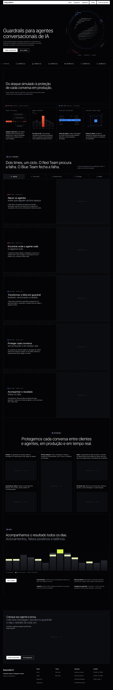

# Sistema de design do Neônio

O Neônio é um Tema do Projeto `portal-rai`: a Home do portal de um time de Responsible AI, quase preta, em blocos e filetes, com o branco puro como contraste e a cor em pontos. Este documento descreve o Sistema de design dele nas seções do formato DESIGN.md do Google Labs.

Os valores não estão aqui. A única fonte deles é o bloco `@theme` de [`web/app/globals.css`](web/app/globals.css), e este documento cita cada token pelo nome da variável. Para ver os valores desenhados, abra a rota `/design-system` do app (como rodar está no [README](README.md#como-rodar)) ou as Capturas dela: [`screenshots/design-system-1440.png`](screenshots/design-system-1440.png) e [`screenshots/design-system-390.png`](screenshots/design-system-390.png).

**Como ler os nomes.** A classe do Tailwind é o nome do token sem o prefixo do namespace: `--color-page` dá `bg-page`, `text-page` e `border-page`; `--text-15` dá `text-15`; `--radius-6` dá `rounded-6`; `--spacing-gutter` dá `px-gutter`; `--container-page` dá `max-w-page`; `--grid-template-columns-hero` dá `grid-cols-hero`; `--grid-auto-columns-tabs` dá `auto-cols-tabs`; `--background-image-hatch` dá `bg-hatch`. Uma cor ou um comprimento de um papel só leva o nome do papel (`--color-page`, `--color-tab-current`, `--spacing-section`). Um valor de escala leva o nome do valor: `--text-15` é o tamanho de 15 px; `--text-10-5` é o de 10,5 px, com hífen no lugar da vírgula; `--text-38-64` cresce de 38 a 64 px; `--leading-1375` é a altura de linha 1,375, em milésimos; `--tracking-tight-20` é o espaçamento de 20 milésimos de em negativos, e `--tracking-wide-30`, o de 30 positivos. Os tokens do logo Ondas guardam os nomes do componente dele, com `logo` no nome (`--color-logo-blue`, `--font-logo`, `--text-logo`), e por isso ficam separados dos tokens da página.

**Nomear sem normalizar.** Cada valor do design tem o seu token, com o nome do valor como ele foi achado, e valores parecidos não foram fundidos. O Neônio tem muitos: dez cinzas de filete e de superfície, duas pilhas de fallback para o mesmo mono, quatro alturas de linha de título e dois vermelhos e dois azuis para o mesmo sentido. O que parece inconsistente está em [Observações](#observações), para você decidir o que corrigir no seu projeto.

**Só existe o que o Tema tem.** O tema padrão do Tailwind está zerado: a paleta, a escala de tipo, os raios, as sombras e as quebras dele não geram classe. Só a escala de espaçamento volta, pela base `--spacing`.

## Visão geral

Uma página só, quase preta, que apresenta o time e os dois times dele. O fundo é `--color-page`, e o branco puro, `--color-white`, faz o contraste: os blocos do cabeçalho, os botões e os títulos. Os cinzas, com um leve tom violeta, separam o texto em camadas e desenham os filetes de 1 px que dividem tudo; nas grades, os filetes são os próprios vãos entre as células. A cor aparece em pontos: o quadrado de neon dos rótulos, violeta numa seção sem time, vermelho no Red Team e azul no Blue Team; as ilustrações das soluções e o gráfico de Dados, em vermelho, azul e lima; e o logo Ondas, com os vermelhos e azuis dele.

Os títulos são leves, em Inter Tight, com as letras apertadas; o texto é Inter; o mono, JetBrains Mono, fica nos sobretítulos, nos rótulos, nos títulos dos cartões e nas ilustrações. Os cantos são retos, menos os dos sobretítulos, dos espaços reservados do bento, dos quadrados de neon e de alguns traços das ilustrações. A página quase não se move: a faixa de marcas rola, as abas do ciclo acompanham a rolagem, os hovers trocam o fundo ou a cor, e o logo Ondas anima, em caracteres, as ondas que chegam ao anel de guardrails em volta do agente e as que saem dele. Com movimento reduzido, a faixa, as transições e o logo param.

A Home, de cima para baixo:

- **Cabeçalho** fixo, de três blocos brancos: a marca com a navegação (Dados, Playground, Integrações), "Contato" e "Testar um guardrail".
- **Abertura** em duas colunas alinhadas embaixo: título, parágrafo, um botão branco e um contornado; ao lado, o logo Ondas e a legenda de caracteres dele.
- **Marcas**: a faixa rolante das oito marcas de exemplo, `[MARCA 1]` a `[MARCA 8]`, com as pontas esmaecidas.
- **Soluções**: título, parágrafo e as colunas dos dois times numa grade de filetes, cada uma com dois cartões ilustrados: Agente de Ataque, Semana Vermelha, Guardrail Antiataque e Guardrail Ética Saída.
- **Ciclo integrado**: sobretítulo, título, a barra fixa das cinco abas (Atacar, Descobrir, Desenvolver, Proteger, Medir) e as cinco etapas, cada uma com texto e um espaço reservado de GIF.
- **Integrações**: título centrado e um bento de cinco cartões, cada um com um espaço reservado de GIF.
- **Dados**: título, o gráfico de 14 barras, ilustrativo e sem valores, com legenda; o botão "Ver os dados" e quatro legendas.
- **Chamada final**: um espaço reservado de GIF do tamanho da seção, com o título e uma linha no alto e dois botões embaixo.
- **Rodapé**, o destino de "Contato": marca, slogan, `[NOME DA COMPANHIA]` e quatro colunas (Portal, Times, Soluções, Contato).

## Cores

A página e o branco:

| Token | Papel |
|---|---|
| `--color-page` | fundo da página, dos cartões, das colunas e das abas; texto sobre cor: nos blocos do cabeçalho, no botão branco, na linha bloqueada da tabela do Guardrail Antiataque e na etiqueta "atendimento" do Agente de Ataque |
| `--color-white` | títulos, blocos do cabeçalho, botão branco e borda do contornado, abertura em negrito das legendas, aba atual, texto dos sobretítulos, anel de foco, link do rodapé em hover |
| `--color-text` | cor de base do texto, na raiz da página |
| `--color-nav-hover` | link da navegação em hover, sobre o bloco branco |
| `--color-white-hover` | bloco branco do cabeçalho e botão branco em hover |
| `--color-white-10` | botão contornado em hover |

Cinzas de texto, do claro ao escuro:

| Token | Papel |
|---|---|
| `--color-secondary` | legendas dos cartões, nomes dos times, parágrafos das etapas e da chamada final, dia em andamento na Semana Vermelha |
| `--color-muted` | parágrafos que abrem a abertura e as seções, segunda linha dos títulos, legenda do logo, marcas de exemplo, abas, rótulos das etapas, legendas de Dados, rodapé, linha da Semana Vermelha |
| `--color-subtle` | cabeçalhos dos times, títulos dos cartões, texto das ilustrações e borda das etiquetas delas |

Filetes e superfícies:

| Token | Papel |
|---|---|
| `--color-rule` | filetes de tudo e cor dos vãos de 1 px das grades de filetes; borda dos sobretítulos; hachura entre as etapas; listras das barras da Semana Vermelha |
| `--color-rule-strong` | borda de cima das barras, na Semana Vermelha e no gráfico, e da amostra de Acionamentos |
| `--color-faint` | ramos da ilustração do Agente de Ataque; rótulos dos espaços reservados |
| `--color-rule-subtle` | borda dos espaços reservados e da chamada final; eixos da ilustração do Guardrail Ética Saída |
| `--color-ruling` | pautas da ilustração do Agente de Ataque |
| `--color-grid` | linhas da grade do gráfico de Dados |
| `--color-placeholder` | fundo dos espaços reservados e da chamada final |
| `--color-tab-current` | fundo da aba atual |
| `--color-bar-top` | topo do degradê das barras do gráfico; amostra de Acionamentos na legenda |
| `--color-bar-bottom` | base do degradê das barras do gráfico |

Acentos das ilustrações e dos quadrados de neon, cada um com um sentido: vermelho é o Red Team, azul é o Blue Team, violeta é uma seção sem time e lima são os falsos positivos do gráfico.

| Token | Papel |
|---|---|
| `--color-red` | linha da conversa, pontos e etiqueta "atendimento" da ilustração do Agente de Ataque |
| `--color-red-neon` | quadrado de neon vermelho; topo da barra do dia em andamento |
| `--color-red-glow` | brilho do quadrado de neon vermelho |
| `--color-red-deep` | base da barra do dia em andamento |
| `--color-red-pale` | borda de cima da barra do dia em andamento |
| `--color-blue` | quadrados da ilustração do Guardrail Ética Saída; linha bloqueada da tabela do Guardrail Antiataque |
| `--color-blue-neon` | quadrado de neon azul |
| `--color-blue-glow` | brilho do quadrado de neon azul |
| `--color-violet-neon` | quadrado de neon dos sobretítulos |
| `--color-violet-glow` | brilho do quadrado de neon dos sobretítulos |
| `--color-lime` | falsos positivos do dia em foco, no gráfico |
| `--color-lime-pale` | falsos positivos dos outros dias; amostra deles na legenda |

Do logo Ondas, com os nomes do componente dele. Cada camada do desenho tem a sua cor, e a legenda da abertura usa as mesmas:

| Token | Papel |
|---|---|
| `--color-logo-agent` | o agente, a esfera de caracteres do centro; "*" na legenda |
| `--color-logo-blue` | o anel de guardrails; ":" na legenda |
| `--color-logo-red` | o que precisa ser barrado: os ataques que chegam e as respostas inválidas; "×" na legenda |
| `--color-logo-gray` | o que pode passar: as respostas válidas |
| `--color-logo-bright` | a cor de base do logo, que as camadas cobrem |
| `--color-logo-night` | o fundo padrão do logo; na abertura, o app passa `--color-page` no lugar dele |

## Tipografia

Cinco famílias, quatro fontes:

- `--font-sans` (Inter) é o texto da página: parágrafos, legendas, navegação, botões, abas, títulos das etapas e o rodapé.
- `--font-display` (Inter Tight) é a dos títulos, da marca e das marcas de exemplo.
- `--font-mono` (JetBrains Mono, com a pilha de fallback longa do design) fica nos sobretítulos e na legenda do gráfico; `--font-mono-short` (a mesma fonte, com a pilha curta) fica nos outros rótulos mono, nos títulos dos cartões, nas ilustrações e na legenda do logo.
- `--font-logo` (Geist Mono) desenha os caracteres do logo Ondas.

As quatro são fontes variáveis guardadas em [`web/fonts/`](web/fonts/), cada uma com a licença ao lado, e carregadas por [`web/app/fonts.ts`](web/app/fonts.ts) só no subconjunto latin. `--default-font-family` e `--default-mono-font-family` são apelidos de `--font-sans` e `--font-mono`.

Três pesos: `--font-weight-light` nos títulos em Inter Tight, `--font-weight-normal` no texto, nos títulos das etapas e nos rótulos mono, `--font-weight-medium` na marca, nas marcas de exemplo, na navegação, nos botões, nos títulos do rodapé, na abertura em negrito das legendas e nos rótulos dos espaços reservados.

Os tamanhos fixos são nomeados em px. Os fluidos, de `--text-26-32` a `--text-38-64`, crescem com a largura da janela, do mínimo ao máximo que o nome diz. `--text-logo` acompanha a largura do logo, e não a da janela: as 64 colunas de caracteres ocupam o quadrado inteiro. Duas alturas de linha são passos da escala de espaçamento, e não tokens: 20 px (`leading-5`) nos sobretítulos e 22 px (`leading-5.5`) nas legendas. Uma célula vazia herda o valor da base da página.

| Papel | Família | Tamanho | Peso | Altura de linha | Espaçamento entre letras |
|---|---|---|---|---|---|
| Base da página | sans | `--text-16` | normal | `--leading-1375` | `--tracking-tight-10` |
| Título da abertura | display | `--text-38-64` | light | `--leading-1125` | `--tracking-tight-20` |
| Título de Integrações | display | `--text-32-52` | light | `--leading-1120` | `--tracking-tight-20` |
| Título do Ciclo integrado | display | `--text-32-48` | light | `--leading-1120` | `--tracking-tight-20` |
| Títulos de Soluções e Dados | display | `--text-32-44` | light | `--leading-1120` | `--tracking-tight-20` |
| Título da chamada final | display | `--text-26-32` | light | `--leading-1130` | `--tracking-tight-15` |
| Títulos das etapas | sans | `--text-28` | normal | `--leading-1140` | `--tracking-tight-20` |
| Marca do rodapé | display | `--text-22` | medium | | `--tracking-tight-30` |
| Marca do cabeçalho | display | `--text-19` | medium | | `--tracking-tight-30` |
| Marcas de exemplo | display | `--text-19` | medium | | `--tracking-tight-20` |
| Abas | sans | `--text-18` | normal | | `--tracking-tight-10` |
| Parágrafos sob os títulos | sans | `--text-16` | normal | `--leading-1400` | |
| Legendas dos cartões e de Dados | sans | `--text-16` | normal; a abertura em medium | `leading-5.5` | |
| Botões | sans | `--text-16` | medium | | `--tracking-tight-10` |
| Títulos do rodapé | sans | `--text-15` | medium | | `--tracking-tight-20` |
| Navegação, blocos do cabeçalho e slogan do rodapé | sans | `--text-14` | medium | | |
| Links do rodapé | sans | `--text-14` | normal | | |
| Nome da companhia | sans | `--text-13` | normal | | |
| Sobretítulos, em caixa alta | mono | `--text-14`; `--text-13` a 760 px ou menos | normal | `leading-5` | `--tracking-wide-30` |
| Títulos dos cartões das soluções | mono curta | `--text-15` | normal | `--leading-1250` | |
| Cabeçalhos dos times | mono curta | `--text-12` | normal | `--leading-1300` | |
| Nomes dos times, em caixa alta | mono curta | `--text-12` | normal | `--leading-1300` | `--tracking-wide-60` |
| Rótulos das etapas, em caixa alta | mono curta | `--text-12` | normal | `--leading-1000` | `--tracking-wide-40` |
| Legenda do logo | mono curta | `--text-12` | normal | `--leading-1000` | |
| Legenda do gráfico | mono | `--text-12` | normal | | |
| Rótulos dos espaços reservados, em caixa alta | mono curta | `--text-11` | medium | `--leading-1000` | `--tracking-wide-140` |
| Linhas da tabela do Guardrail Antiataque | mono curta | `--text-11-5` | normal | | |
| Etiquetas das ilustrações e cabeçalho da tabela | mono curta | `--text-10-5` | normal | `--leading-1000` | |
| "7" da Semana Vermelha | display | `--text-30` | light | `--leading-1000` | |
| "dias" da Semana Vermelha | mono curta | `--text-11` | normal | | |
| Dias da Semana Vermelha | mono curta | `--text-10` | normal | | |
| Caracteres do logo | logo | `--text-logo` | normal | `--leading-1200` | herdado da página |

Os sobretítulos são o componente `Eyebrow`: uma etiqueta com borda, o quadrado de neon violeta e o texto em caixa alta, como "Ciclo integrado". Os títulos de duas partes, em Dados, na chamada final e nas etapas, escrevem a segunda em `--color-muted`, numa linha própria.

## Layout

- **Largura.** A abertura, o `main` e o rodapé medem no máximo `--container-page`, centrados, com `--spacing-gutter` de respiro de cada lado; a faixa de marcas mede o mesmo, sem respiro. O cabeçalho tem o mesmo respiro, e a fila dos blocos dele mede no máximo `--container-header`.
- **A moldura de filetes.** Dentro do `main`, Soluções, Ciclo integrado, Integrações e Dados ficam numa coluna com um filete de cada lado. O texto dentro dela tem `--spacing-inset` de respiro; as grades encostam nos filetes. A chamada final fica fora da moldura, logo abaixo, e o rodapé fora do `main`.
- **Grades de filetes.** Os times, os cartões das soluções, a barra de abas e o bento são grades com vão de 1 px sobre um fundo `--color-rule` e células em `--color-page`: o vão é o filete.
- **Espaçamento.** É a escala do Tailwind, sobre a base `--spacing`: todo comprimento fixo do design é um passo dela (`gap-2.5`, `py-1.75`, `scroll-mt-29.5`). Os fluidos têm nome: `--spacing-gutter`, o respiro lateral da página; `--spacing-inset`, o de dentro da moldura; `--spacing-section`, o espaço acima de cada seção e da chamada final; `--spacing-teams`, acima das colunas dos times; `--spacing-panel-y` e `--spacing-panel-x`, o respiro do texto das etapas; `--spacing-bars`, o vão entre as barras do gráfico; `--spacing-cta-top`, `--spacing-cta-x` e `--spacing-cta-bottom`, o respiro da chamada final, e `--spacing-cta-height`, a altura mínima dela.
- **Grades com nome.** `--grid-template-columns-hero` põe o texto da abertura ao lado do logo, que mede até 600 px; `--grid-template-columns-verdict` dá as três colunas da tabela do Guardrail Antiataque; `--grid-template-columns-footer` põe quantas colunas de links couberem, cada uma com no mínimo 160 px; `--grid-auto-columns-tabs` dá a cada aba no mínimo 136 px. Grades de colunas iguais usam as classes do próprio Tailwind (`grid-cols-2`, `grid-cols-3`).
- **Quatro quebras**, cada uma valendo na largura que o nome diz e abaixo dela, declaradas como `@custom-variant` em `globals.css`, fora do `@theme`:
  - `upto-1100:`, a 1100 px ou menos: as colunas dos times empilham; o bento passa a duas colunas, e o cartão alto ocupa uma linha inteira.
  - `upto-900:`, a 900 px ou menos: a abertura empilha, com o logo primeiro, centrado e com no máximo 520 px (`max-w-130`); as etapas do ciclo empilham, com o espaço reservado embaixo do texto.
  - `upto-760:`, a 760 px ou menos: o cabeçalho deixa de ser fixo e rola com a página, a barra de abas gruda no topo da janela, os sobretítulos descem para `--text-13` e as legendas de Dados ficam numa coluna.
  - `upto-640:`, a 640 px ou menos: os cartões das soluções empilham, com menos respiro, e o bento fica numa coluna.
- **O cabeçalho.** Os três blocos ficam numa fila que quebra quando não cabe. Só eles recebem o ponteiro: a caixa do cabeçalho deixa os cliques passarem para a página em volta deles.
- **Camadas.** O cabeçalho fica por cima da página. A barra de abas gruda logo abaixo dele (`top-13.5`) e passa por cima das etapas; ao rolar até uma etapa, a âncora para abaixo do cabeçalho e da barra (`scroll-mt-29.5`; a 760 px ou menos, só abaixo da barra, `scroll-mt-16`).
- **Alvos de toque.** Os blocos do cabeçalho, a marca, os links da navegação, os botões, as marcas de exemplo e os links do rodapé têm 44 px de altura mínima (`min-h-11`); as abas têm mais.

## Formas

| Token | Onde |
|---|---|
| `--radius-2` | quadrados de neon |
| `--radius-6` | sobretítulos, espaços reservados do bento e cantos dos ramos da ilustração do Agente de Ataque |
| `--radius-circle` | pontos da ilustração do Agente de Ataque |

- **Cantos retos** em todo o resto: blocos do cabeçalho, botões, cartões, abas, a chamada final e os espaços reservados das etapas.
- **Filetes** de 1 px em `--color-rule` separam tudo, e nas grades são os vãos entre as células. Entre duas etapas do ciclo, uma faixa hachurada, `--background-image-hatch`.
- **Profundidade.** A página é plana, sem sombra. A única luz é a dos quadrados de neon (`NeonSquare`): três quadrados empilhados, um brilho desfocado em `--blur-5` (`--blur-4` no pequeno), uma luz desfocada em `--blur-2` e um quadrado nítido por cima.
- **Fundos desenhados.** Seis degradês têm nome: `--background-image-ruled`, as pautas do Agente de Ataque; `--background-image-week-bar` e `--background-image-week-bar-current`, as barras da Semana Vermelha e a do dia em andamento; `--background-image-hatch`, a hachura entre as etapas; `--background-image-chart`, a grade do gráfico; `--background-image-chart-bar`, o degradê das barras dele.
- **Esmaecimento.** A faixa de marcas some nas pontas por uma máscara, de 0 a 7% e de 93% a 100% da largura, definida em `marquee-viewport`, em `globals.css`.
- **Foco.** O foco de teclado (`:focus-visible`) desenha um anel de espessura `--outline-width-focus` em `--color-white`, afastado `--outline-offset-focus` do elemento. Sobre o branco, na marca e nos links da navegação, o anel é `--color-page` e fica por dentro, `--outline-offset-inset`; nas abas, fica por dentro, em branco. É a única regra global do app, em `@layer base` de `globals.css`.

## Movimento

O Neônio tem três movimentos: as transições de hover, a faixa de marcas e o logo. Não há entrada no carregamento nem animação guiada por scroll. Com movimento reduzido, os três param: a faixa fica parada no começo, nenhuma transição corre, nem as de hover, e o logo fica no quadro de repouso.

| O quê | Utilidade | Tokens e keyframes | Onde |
|---|---|---|---|
| Transição de hover | `transition-[…]` | `--default-transition-duration`, `--default-transition-timing-function` | blocos do cabeçalho, navegação, botões, abas, links do rodapé |
| Faixa de marcas | `marquee-viewport`, `marquee-track` | `--animate-marquee`, que usa `brands-marquee` e `--duration-marquee` | Marcas, que pausam com o ponteiro sobre a faixa |
| Rolagem até uma âncora | | | suave, só sem movimento reduzido |
| Sem transição com movimento reduzido | `transitions-off-when-reduced` | | na raiz da página |

A faixa leva duas cópias da lista de marcas e desliza uma cópia inteira a cada volta, sem emenda. As abas acompanham a rolagem por script, sem animação: a aba atual é a da última etapa cujo topo passou de 0,33 da área visível abaixo da barra, área contada até 900 px; com a página no topo, é "Atacar".

O logo Ondas anima por `requestAnimationFrame`, a 85 ms por quadro contados do relógio. O desenho é função pura do quadro: o mesmo quadro desenha sempre a mesma imagem. Com movimento reduzido, ou com `animated={false}`, ele fica no quadro de partida.

## Componentes

Os componentes ficam em [`web/components/`](web/components/), um por arquivo. Os nove blocos da página, marcados com `data-block`, compõem a Home em [`web/app/page.tsx`](web/app/page.tsx). As peças que eles usam aparecem isoladas, nos seus estados, na rota `/design-system`, e a faixa de marcas também, rolando e pausada. Cada peça importa só `react` e as peças irmãs, e o estilo dela são classes de token.

| Bloco | Arquivo | Peças que usa |
|---|---|---|
| `SiteHeader` | `site-header.tsx` | `NavLink`, `HeaderBlockLink` |
| `Hero` | `hero.tsx` | `Lead`, `ButtonLink`, `OndasLogo`, `OndasCaption` |
| `Brands` | `brands.tsx` | |
| `Solutions` | `solutions.tsx` | `SectionTitle`, `Lead`, `NeonSquare`, `Caption` e os quatro desenhos, sobre `IllustrationFrame` |
| `IntegratedCycle` | `integrated-cycle.tsx` | `Eyebrow`, `SectionTitle`, `Lead`, `NeonSquare`, `MediaPlaceholder`, `CycleTabs`, `CycleTab` e os cinco ícones |
| `Integrations` | `integrations.tsx` | `Eyebrow`, `SectionTitle`, `Caption`, `MediaPlaceholder` |
| `DataSection` | `data-section.tsx` | `Eyebrow`, `SectionTitle`, `DataChartIllustration`, `ButtonLink`, `Caption` |
| `FinalCta` | `final-cta.tsx` | `PlaceholderMark`, `Lead`, `ButtonLink` |
| `SiteFooter` | `site-footer.tsx` | `FooterLink` |

O texto da Home fica nos blocos. As partes que só um bloco usa, sem estado próprio, ficam dentro dele: a lista de marcas, o cartão e a coluna de um time nas soluções, a etapa do ciclo, o cartão do bento e a coluna do rodapé.

| Peça | Arquivo | Propriedades | Estados |
|---|---|---|---|
| `HeaderBlockLink` | `header-block-link.tsx` | `children`; `href?` | repouso, hover, foco; sem `href`, inerte |
| `NavLink` | `nav-link.tsx` | `children` | repouso, hover, foco; sempre inerte, porque as Telas dele não existem |
| `InertLink` | `inert-link.tsx` | os de um `<a>`, menos `href` | repouso, foco; é o link de uma Lacuna, que não navega |
| `ButtonLink` | `button-link.tsx` | `children`; `variant`: `white` ou `outline`; `href?` | repouso, hover, foco, em cada variante; sem `href`, inerte |
| `FooterLink` | `footer-link.tsx` | `children`; `href?`, uma âncora da Home | repouso, hover, foco; sem `href`, inerte |
| `Lead` | `lead.tsx` | `children`; `tone?`: `muted` (padrão) ou `secondary`; `className?`, para a largura | muted, secondary |
| `SectionTitle` | `section-title.tsx` | `children`; `id?`; `size?`: `32-48` (padrão), `32-44` ou `32-52`; `className?` | cada tamanho |
| `Eyebrow` | `eyebrow.tsx` | `children`; `align?`: `start` (padrão) ou `center` | start, center |
| `NeonSquare` | `neon-square.tsx` | `team?`: `violet` (padrão), `red` ou `blue`; `size?`: `regular` (padrão) ou `small` | cada cor, cada tamanho |
| `Caption` | `caption.tsx` | `lead`, a abertura em negrito; `children`; `variant`: `card`, `bento` ou `feature` | card, bento, feature |
| `IllustrationFrame` | `illustration-frame.tsx` | `label`, o que o desenho mostra; `children`; `className?` | |
| `AttackAgentIllustration`, `RedWeekIllustration`, `AntiAttackGuardrailIllustration`, `OutputEthicsGuardrailIllustration` | um `*-illustration.tsx` cada | nenhuma | |
| `CycleTabs` | `cycle-tabs.tsx` | `tabs`: o destino, o rótulo e o ícone de cada aba | |
| `CycleTab` | `cycle-tab.tsx` | `href`, a âncora da etapa; `icon`; `children`; `current`; `onClick?` | repouso, hover, foco, atual |
| `AttackIcon`, `DiscoverIcon`, `DevelopIcon`, `ProtectIcon`, `MeasureIcon` | `cycle-icons.tsx` | nenhuma | |
| `MediaPlaceholder` | `media-placeholder.tsx` | `label`, o rótulo; `variant?`: `card` (padrão) ou `step`; `className?`, para a proporção | card, step |
| `PlaceholderMark` | `media-placeholder.tsx` | `label`; `className?` | |
| `DataChartIllustration` | `data-chart-illustration.tsx` | nenhuma | |
| `OndasLogo` | `ondas-logo.tsx` | `background?`, qualquer cor CSS, no lugar de `--color-logo-night`; `animated?`, padrão `true`; `frame?`, o quadro de partida (0 escolhe o de repouso) | animado, parado |
| `OndasCaption` | `ondas-caption.tsx` | nenhuma | |

**As abas do ciclo** são âncoras, e não abas no sentido de ARIA: cada uma leva à etapa dela, e a atual diz que é a atual com `aria-current="step"`. `CycleTabs` é o único estado do bloco: guarda a aba atual, que muda no clique e na rolagem.

**Os desenhos** das soluções e o gráfico de Dados são marcação com CSS, sem imagem: cada marca fica na posição que o design deu, em porcentagem da moldura, e por isso o desenho acompanha a largura do cartão. A cor sempre vem de token. Cada desenho é uma imagem só, com o rótulo do design no lugar.

**O logo Ondas** é texto, sem SVG: uma grade de 64 por 32 caracteres em `--font-logo`, em quatro camadas sobrepostas, cada uma na sua cor. No centro, o agente conversacional é uma esfera de caracteres que gira, em `--color-logo-agent`. Em volta, o anel de guardrails, em `--color-logo-blue`, é feito de ":" que uma varredura de "=" percorre. Os ataques chegam de fora como frentes de onda de "×", em `--color-logo-red`, e quebram no anel, que se fecha em "#" no ponto do impacto. As respostas do agente saem como ondas: as válidas, de "o" e "·" em `--color-logo-gray`, atravessam o anel; as inválidas, de "ø" em `--color-logo-red`, são barradas por dentro. A legenda (`OndasCaption`) nomeia três camadas pelo caractere delas, cada caractere na cor da camada: "×" ataque, ":" guardrails e "*" agente, numa linha só que não quebra.

O componente do logo é o mesmo arquivo nos Temas do Projeto que o desenham; só o fundo passado muda. Na abertura do Neônio, o fundo é `--color-page`, a cor da página.

## O que fazer e o que não fazer

Fazer:

- Usar só os tokens do `@theme`. Um valor novo entra lá primeiro, com nome.
- Separar seções, colunas e cartões por filete, e não por sombra: nas grades, o vão de 1 px sobre `--color-rule`.
- Escrever os títulos de seção em `--font-display` e `--font-weight-light`, com a altura de linha e o espaçamento entre letras do papel deles.
- Marcar um time com o quadrado de neon na cor dele, vermelho ou azul, como nos cabeçalhos dos times e nos rótulos das etapas; o `Eyebrow` de uma seção sem time leva o violeta.
- Dar matiz só com sentido: vermelho para o Red Team, azul para o Blue Team, lima para os falsos positivos.
- Deixar os cantos retos, fora dos três raios da tabela.
- Parar a faixa de marcas, as transições e o logo quando o movimento é reduzido.
- Manter os alvos de toque de 44 px e o anel de foco branco, por dentro sobre o branco.
- Deixar inerte, com `InertLink`, todo link para uma Tela ou um destino que o design não definiu, e manter os espaços reservados como estão.

Não fazer:

- Pôr sombra ou raio em bloco, botão ou cartão.
- Usar as cores do logo fora do logo e da legenda dele, ou os vermelhos e azuis das ilustrações no logo.
- Animar sem a guarda de movimento reduzido, nem deixar uma transição correr com ele.
- Escrever cor em hex num componente, inclusive nos desenhos e no logo: as cores chegam por classe de token.
- Fundir tokens parecidos dentro deste app. Cada papel tem o seu valor; no seu projeto, a decisão é sua, com as Observações abaixo.

## Observações

Inconsistências aparentes que o design carrega e o app reproduz como estão. Corrigi-las cabe ao Autor, no design, ou a você, no seu projeto.

**No design**

1. **Pesos pedidos e não usados.** O design pede ao Google Fonts a Inter em 600 e a Inter Tight em 400, e o design do logo pede a Geist Mono em 500. Nenhum texto usa esses pesos: a página só usa `--font-weight-light`, `--font-weight-normal` e `--font-weight-medium`. O app guarda o arquivo variável inteiro de cada fonte, então os pesos existem, sem uso.
2. **Dois vermelhos e dois azuis para o mesmo sentido.** As ilustrações e os quadrados de neon usam `--color-red` e `--color-blue` e as variantes deles; o logo e a legenda dele usam `--color-logo-red` e `--color-logo-blue`, de outro valor. Os dois pares dizem a mesma coisa, Red Team e ataque, Blue Team e guardrail.
3. **Duas pilhas para o mesmo mono.** O JetBrains Mono vem com a pilha de fallback longa nos sobretítulos e na legenda do gráfico, e com a curta nos outros rótulos. Com a fonte carregada, as duas desenham igual; sem ela, caem em fontes diferentes. Viraram `--font-mono` e `--font-mono-short`.
4. **Títulos do rodapé depois do último título de seção.** As colunas do rodapé têm títulos de terceiro nível que vêm logo depois do título da chamada final, então, na estrutura da página, elas parecem subseções da chamada final.
5. **Os títulos das etapas.** São os únicos títulos grandes em `--font-sans` e `--font-weight-normal`; todos os outros títulos de seção são `--font-display` em `--font-weight-light`.
6. **A cor de base quase não aparece.** `--color-text` é a cor do texto na raiz da página, mas quase todo texto define a própria cor.
7. **Uma margem que nunca vale.** A regra das legendas declara uma margem de 32 px acima e, logo depois, a margem automática que empurra a legenda para o fim do cartão. Nos cartões das soluções, os 32 px nunca valem: o que separa a legenda do desenho é o respiro interno de 28 px (`pt-7`).
8. **A faixa parada mostra só o começo.** Com movimento reduzido, a faixa fica no começo da volta: em 1440 px a `[MARCA 8]` nunca aparece, e em telas estreitas só aparecem as primeiras. A `[MARCA 1]` começa na ponta esmaecida, e o desenho dela fica meio apagado.
9. **A linha da Semana Vermelha não acompanha as barras.** A linha é desenhada numa caixa esticada sobre as barras, com cada vértice no meio de um sétimo da largura. As barras têm um vão entre si (`gap-2.25`), então os vértices escorregam do meio delas, até uns 4 px nas barras das pontas.
10. **Abas que passam da coluna.** Quando as cinco abas não cabem, a barra rola de lado, e cada coluna fica com os 136 px mínimos. A aba cresce com o texto e não cabe nela: Descobrir e Desenvolver transbordam da coluna, a coluna seguinte desenha por cima, e "Desenvolver" aparece cortado quando a barra é rolada até ele. Nada leva a aba atual para a vista quando ela está fora da barra.
11. **A barra conta com o cabeçalho de uma linha.** A barra de abas gruda na altura do cabeçalho em uma linha, e a âncora das etapas também conta com ela. Acima de 760 px, onde o cabeçalho é fixo, os blocos dele quebram em duas linhas quando não cabem: aí o cabeçalho cobre o alto da barra.
12. **A etapa para embaixo do filete.** A margem de rolagem das etapas é 1 px menor que a base da barra, com o cabeçalho fixo e a 760 px ou menos: a etapa para com o topo embaixo do filete de baixo da barra.
13. **Um terço que não é um terço.** O scroll-spy usa 0,33 da área abaixo da barra, e não um terço exato, e limita a área a 900 px.
14. **Duas células vazias no bento.** Entre 641 e 1100 px, o cartão alto passa a ocupar uma linha inteira, e o posicionamento automático da grade não volta para preencher as células de cima: à direita de "Entrada." e de "Em tempo real." ficam duas células vazias, que aparecem em `--color-rule`, o fundo da grade.
15. **Links inertes para seções que existem.** "Ver integrações", na chamada final, e Dados e Integrações, no cabeçalho e no rodapé, apontam para `#`, embora a Home tenha as seções de Integrações e de Dados. O app os mantém inertes, como o design.
16. **A chamada final é um espaço reservado.** A seção inteira é a caixa de um GIF ainda por vir, com o rótulo no meio, e o título, a linha e os botões ficam por cima dela. A caixa tem as próprias regras: sem raio, mais alta, com o espaço de seção acima e o parágrafo em `--color-secondary`.
17. **Uma opacidade só.** Os ícones das abas ficam a 0,85 de opacidade; nenhum outro elemento do design tem opacidade abaixo de 1.
18. **O logo herda o espaçamento da página.** O design do logo não define espaçamento entre letras, e na Home ele herda o `--tracking-tight-10` da página: os caracteres ficam um pouco mais juntos que no logo sozinho.
19. **A legenda nomeia três das quatro camadas.** As respostas do agente ficam sem item: as válidas, em `--color-logo-gray`, e as inválidas, "ø" em `--color-logo-red`.
20. **A cor de base do logo não aparece.** O logo declara `--color-logo-bright` como cor do texto, mas cada camada pinta com a própria cor, e nenhum caractere sai nela.
21. **A regra da legenda pega o caractere.** A regra que alinha cada item da legenda do logo também pega o caractere dentro dele, que vira uma caixa flexível com vão. Sem efeito no desenho; o app reproduz.
22. **Valores quase iguais.** Postos lado a lado: quatro alturas de linha de título (`--leading-1120`, `--leading-1125`, `--leading-1130`, `--leading-1140`); dois espaçamentos de título a meio centésimo de em (`--tracking-tight-15` e `--tracking-tight-20`); dois cinzas de hover sobre o branco (`--color-nav-hover` e `--color-white-hover`); e cinzas escuros a um nível um do outro em cada canal (`--color-ruling` e `--color-grid`; `--color-tab-current` e `--color-bar-bottom`). Cada papel tem o seu.

**No Sistema de design do app**

23. **As quebras fora do `@theme`.** As quatro quebras são `@custom-variant` de `globals.css`, por isso a rota `/design-system`, que lê o `@theme`, não as mostra. Elas estão descritas em [Layout](#layout).
24. **A opacidade sem token.** Os 0,85 dos ícones das abas ficam na classe `opacity-85` do Tailwind: o Tailwind 4 não tem namespace de tema para opacidade.
25. **Tokens técnicos.** Três tokens não vêm do design: `--spacing`, a base da escala de espaçamento do Tailwind, e os apelidos `--default-font-family` e `--default-mono-font-family`.
26. **A barra de abas sem etapas, na rota.** Em `/design-system`, `CycleTabs` aparece sem as etapas: a primeira aba fica atual, e um clique marca outra só até a próxima rolagem.
